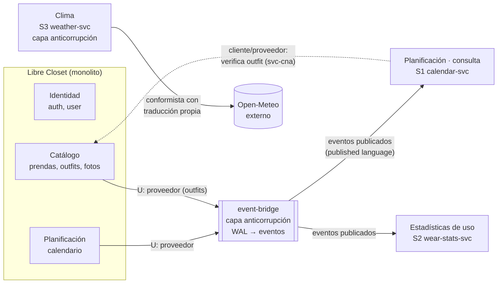

# A1 · Análisis del monolito y mapa de contextos

## F5-E1 · Tablas y relaciones (correr en VM-1 y capturar)

```bash
docker exec closet-postgres psql -U closet -d closet -c '\dt'
docker exec closet-postgres psql -U closet -d closet -c "
SELECT tc.table_name AS tabla, kcu.column_name AS columna, ccu.table_name AS referencia
FROM information_schema.table_constraints tc
JOIN information_schema.key_column_usage kcu ON tc.constraint_name = kcu.constraint_name
JOIN information_schema.constraint_column_usage ccu ON tc.constraint_name = ccu.constraint_name
WHERE tc.constraint_type = 'FOREIGN KEY'
ORDER BY 1, 2;"
```

## Módulos de Libre Closet (v0.6.0)

| Módulo (`src/`) | Responsabilidad | Entidades que usa (según el código) |
| --- | --- | --- |
| `auth` | Registro, login, reset de contraseña, perfil | `User`, `PasswordReset` |
| `wardrobe` · garment | CRUD de prendas, filtros y búsqueda | `Garment`, `User`, `File` (vía `file`) |
| `wardrobe` · outfit | CRUD de outfits | `Outfit`, `Garment`, `User` |
| `wardrobe` · calendar | Agenda de outfits, marcar como usado | `OutfitCalendar`, `Outfit`, `User` |
| `wardrobe-share` | Compartir el guardarropa (ver / editar) | `WardrobeShare`, `User` |
| `file` | Subida y descarga de fotos | `File`, `User` |
| `notification` | Notificaciones push (VAPID) | `UserDevice`, `User` |
| `weather` | Pronóstico y nombre del lugar | ninguna (Open-Meteo y Nominatim, caché en memoria) |
| `open-graph` | Vista previa para compartir | `File`, `Garment`, `Outfit` |

## F5-E2 · Matriz de acoplamiento módulo × tabla

L = lee, E = escribe. Las columnas marcadas con ⚠ son **tablas compartidas** (las usa más de un módulo).

| Módulo | user ⚠ | garment ⚠ | outfit ⚠ | outfit_garments | outfit_calendar | file ⚠ | wardrobe_share | password_reset | user_device |
| --- | --- | --- | --- | --- | --- | --- | --- | --- | --- |
| auth | L/E | | | | | | | L/E | |
| garment | L | L/E | | | | L/E | | | |
| outfit | L | L | L/E | L/E | | | | | |
| **calendar** | L | | **L** | | **L/E** | | | | |
| wardrobe-share | L | | | | | | L/E | | |
| file | L | | | | | L/E | | | |
| notification | L | | | | | | | | L/E |
| open-graph | | L | L | | | L | | | |
| **weather** | | | | | | | | | |

**Lectura de la matriz**

- `user` la usan todos: no se puede extraer sin un servicio de identidad (fuera de alcance).
- `outfit_calendar` **solo la escribe el módulo de calendario**: es la tabla más fácil de "estrangular".
  Su única dependencia es `outfit` (para el nombre), y eso se resuelve recibiendo también los eventos de `outfit`.
- `weather` **no usa ninguna tabla**: solo llama a Open-Meteo. Se extrae sin tocar datos.
- `garment` y `file` están muy acopladas (prendas, outfits, fotos, open-graph): se dejan en el monolito.

Por eso se eligió extraer **calendario (S1), estadísticas de uso derivadas del calendario (S2) y clima (S3)**.

## F5-E3 · Mapa de contextos (DDD)



Relaciones:
- **Planificación y Catálogo → event-bridge**: *upstream*. El bridge es la **capa anticorrupción** que traduce
  filas de tablas internas a eventos de dominio con un sobre común (*published language*, contrato AsyncAPI).
- **S1 y S2**: *downstream*, **conformistas** con ese lenguaje publicado.
- **S1 → Catálogo**: relación **cliente/proveedor** síncrona y opcional (verificar que el outfit exista).
- **S3 → Open-Meteo**: S3 actúa como capa anticorrupción frente a un proveedor externo, con caché y circuito.
