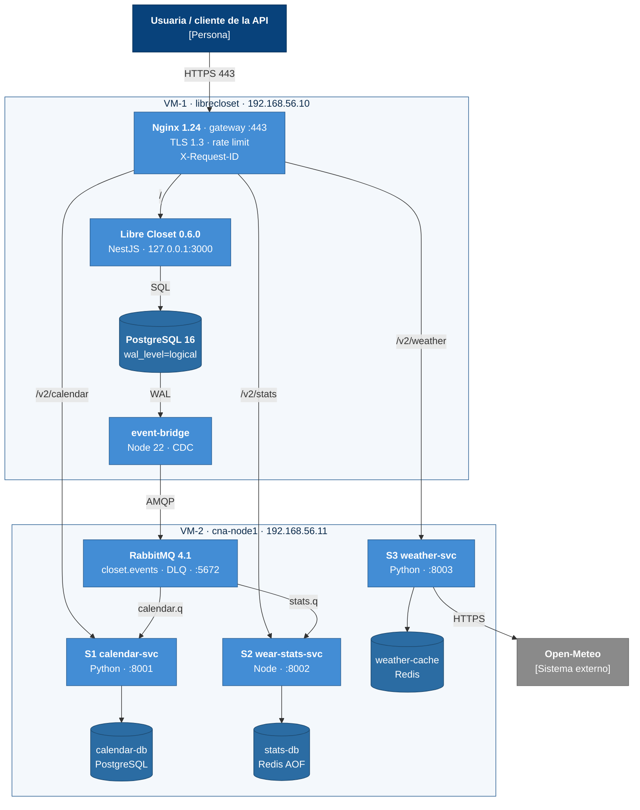

# C4 nivel 2 · Contenedores (F5-E6)

Notación C4 dibujada con un diagrama de flujo de Mermaid: cada recuadro claro es un nodo (VM), los
rectángulos azules son contenedores y los cilindros, almacenes de datos.

Ningún contenedor de VM-2 se conecta a PostgreSQL del monolito; solo el event-bridge, dentro de VM-1
(ADR-006, ADR-009). Además, S1 puede consultar al monolito (`GET /outfits/{id}` con el usuario de
servicio `svc-cna`) para verificar que un outfit existe. En VM-2, UFW y la cadena `DOCKER-USER` solo
aceptan conexiones desde 192.168.56.10.
