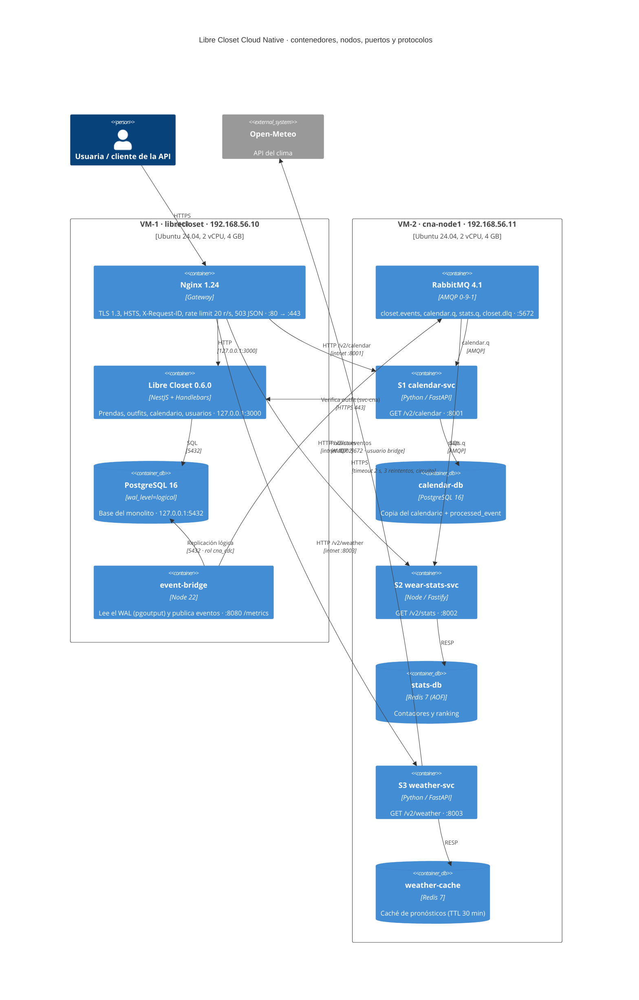

# C4 nivel 2 · Contenedores (F5-E6)

Ningún contenedor de VM-2 se conecta a PostgreSQL del monolito; solo el event-bridge, dentro de VM-1
(ADR-006, ADR-009). En VM-2, UFW y la cadena `DOCKER-USER` solo aceptan conexiones desde 192.168.56.10.
