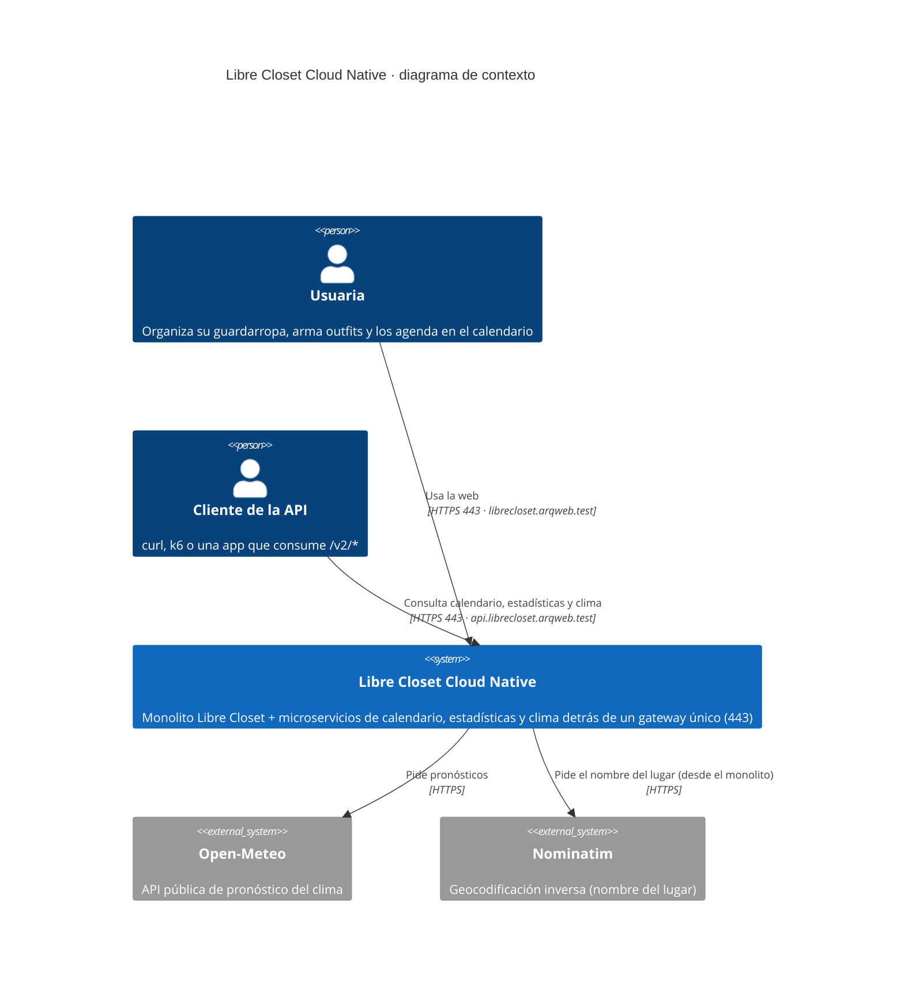

# C4 nivel 1 · Contexto (F5-E5)

Todo el tráfico externo entra por el puerto 443 de VM-1 (CA-4). El sistema depende de dos servicios
externos; solo Open-Meteo está protegido con caché e interruptor de circuito (S3).
