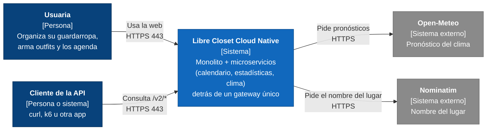

# C4 nivel 1 · Contexto (F5-E5)

Notación C4 dibujada con un diagrama de flujo de Mermaid (personas en azul oscuro, el sistema en azul,
sistemas externos en gris).

Todo el tráfico externo entra por el puerto 443 de VM-1 (CA-4). El sistema depende de dos servicios
externos; solo Open-Meteo está protegido con caché e interruptor de circuito (S3).
