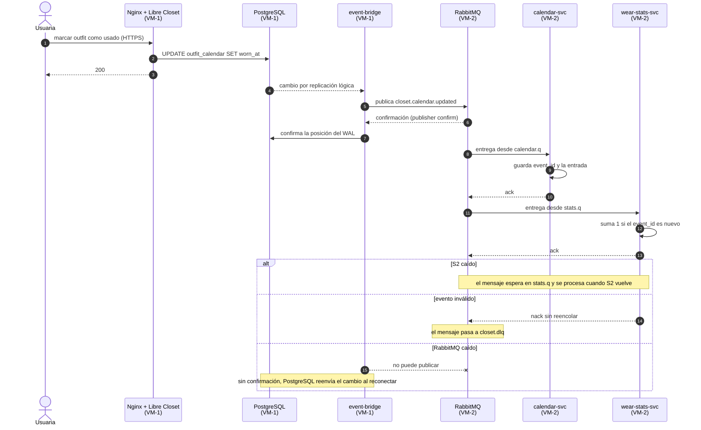
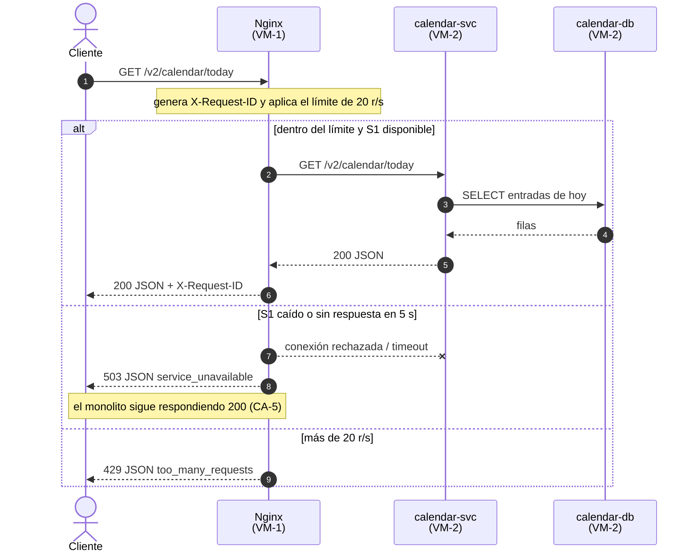
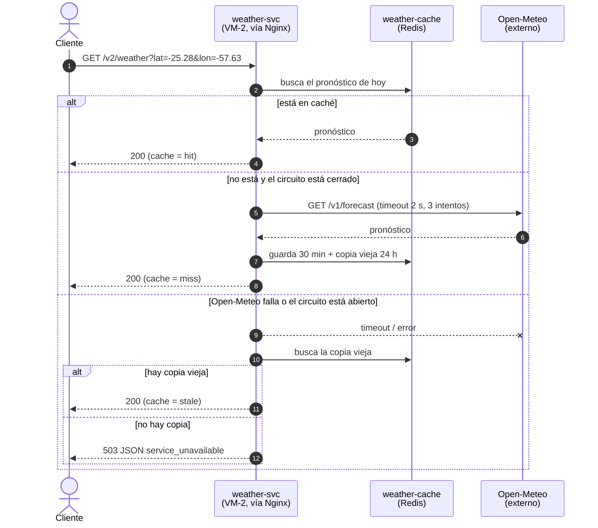

# Diagramas de secuencia (F5-E7)

## 1. Marcar un outfit como usado → calendario y estadísticas (asíncrono)

## 2. Consulta del calendario (síncrono)

## 3. Consulta del clima con caché e interruptor de circuito

