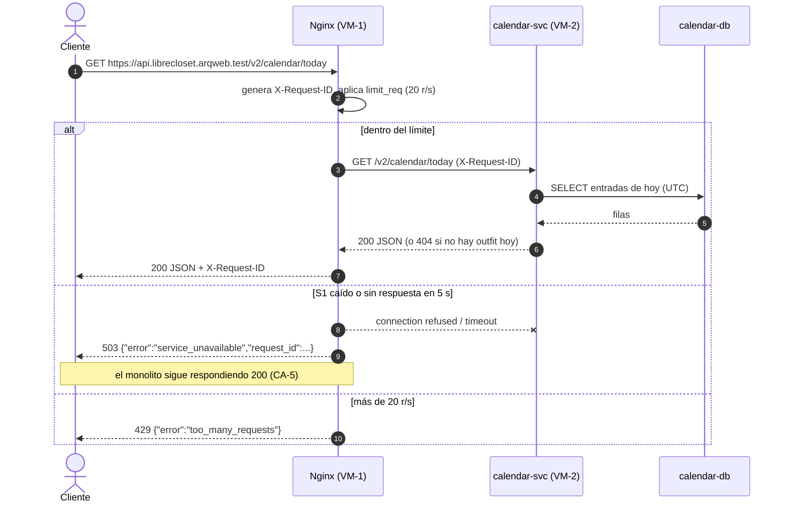
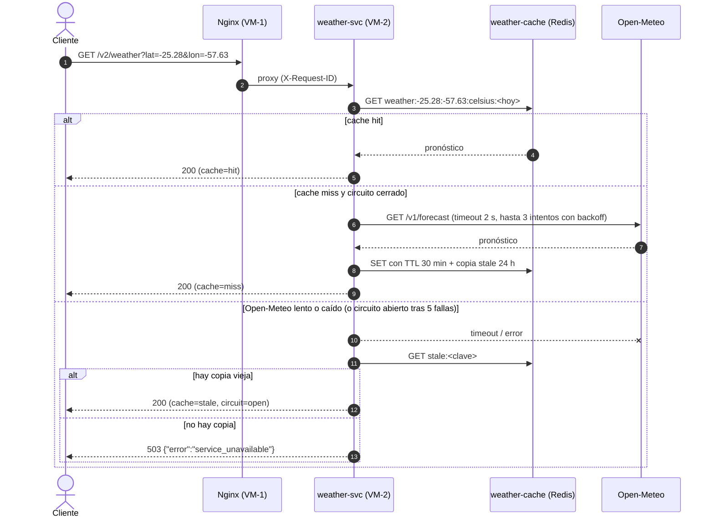

# Diagramas de secuencia (F5-E7)

## 1. Marcar un outfit como usado → calendario y estadísticas actualizados (asíncrono)

```mermaid
sequenceDiagram
  autonumber
  actor U as Usuaria
  participant N as Nginx (VM-1)
  participant L as Libre Closet
  participant P as PostgreSQL
  participant B as event-bridge
  participant R as RabbitMQ (VM-2)
  participant S1 as calendar-svc
  participant S2 as wear-stats-svc

  U->>N: POST /calendar/17/worn (HTTPS)
  N->>L: proxy (X-Request-ID)
  L->>P: UPDATE outfit_calendar SET worn_at = now()
  P-->>L: COMMIT
  L-->>U: 200 (HTMX)
  P-->>B: cambio por replicación lógica (pgoutput)
  B->>R: publish closet.calendar.updated (persistente)
  R-->>B: confirm
  B->>P: acknowledge(LSN)
  par cola calendar.q
    R->>S1: entrega
    S1->>S1: INSERT processed_event + UPSERT calendar_entry (una transacción)
    S1-->>R: ack
  and cola stats.q
    R->>S2: entrega
    S2->>S2: script Lua: SET processed:<event_id> NX + HINCRBY worn
    S2-->>R: ack
  end

  alt S2 caído o con error transitorio
    R-->>R: el mensaje espera en stats.q (o se reencola con nack)
    Note over R,S2: al volver S2 procesa lo pendiente (CA-6); a los 5 intentos va a closet.dlq
  else evento inválido
    S1-->>R: nack sin reencolar
    R->>R: closet.dlx → closet.dlq
  else RabbitMQ caído
    B--xR: publish falla
    Note over B,P: sin acknowledge: PostgreSQL reenvía el cambio cuando el bridge reconecta
  end
```

## 2. Consulta del calendario (síncrona)



## 3. Consulta del clima con caché e interruptor de circuito


